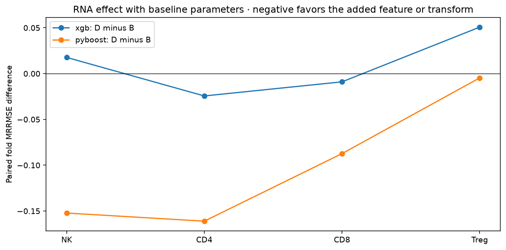
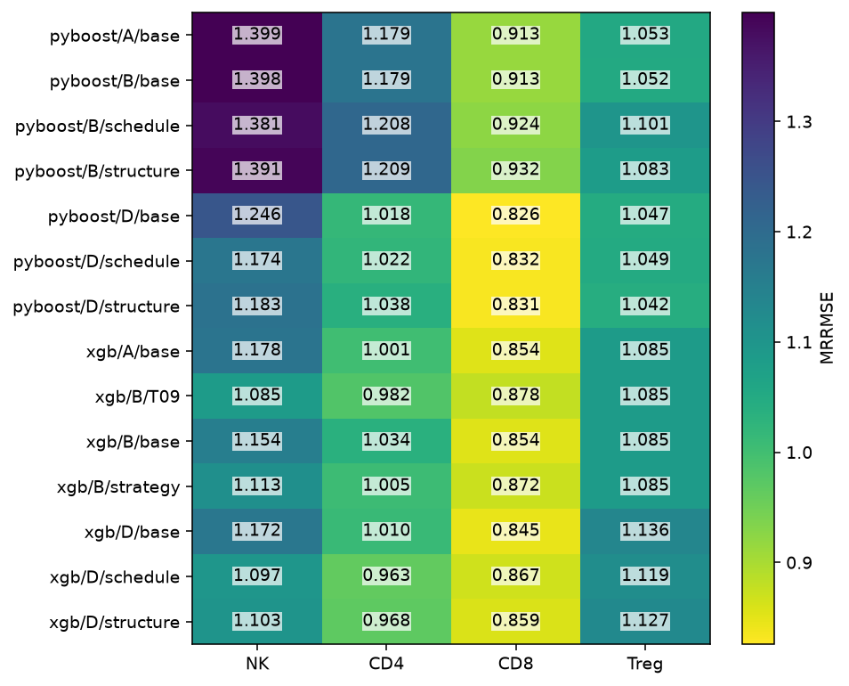

# XGBoost and PyBoost on four sparse-cell splits

**XGBoost T09 achieved the lowest boosting validation mean (1.007402). PyBoost with baseline RNA and PCA160 reached 1.019165.** Both winners were locked before the two late Kaggle submissions. The historical linear model retained the lowest validation error. XGBoost had the lowest Kaggle Private score among these three models.

[Download the standalone HTML report](https://portal.expanse.sdsc.edu/pun/sys/dashboard/files/fs//home/zfan11/expanse/BDD_BOOSTING_COMPARISON_20261119/comparison.html) · [HTML in this archive](report/comparison.html) · [All four-fold results](report/folds.csv) · [Configuration summary](report/trials.csv) · [Matched fold differences](report/paired_differences.csv) · [Final parameters and scores](report/final_models.csv)

| Model | NK | CD4 | CD8 | Treg | Equal-weight mean | Kaggle Public | Kaggle Private |
|---|---:|---:|---:|---:|---:|---:|---:|
| XGBoost B/T09 | 1.084709 | 0.981742 | 0.877665 | 1.085490 | **1.007402** | **0.623** | **0.833** |
| PyBoost D/schedule | 1.173893 | 1.021539 | 0.831902 | 1.049326 | 1.019165 | 0.647 | 0.894 |
| Historical PCA + MRRMSE + L2 | — | — | — | — | 0.969221 | 0.625 | 0.858 |

The historical linear validation mean and private score come from the project reference. The public score was also visible on Kaggle for submission_pca_mrrmse_l2.csv. The validation ranking and the Kaggle ranking reflect different evaluation sets.

## What the comparisons establish

| Baseline inputs and outputs | XGBoost | PyBoost |
|---|---:|---:|
| A · identity, direct gene output | 1.029386 | 1.135826 |
| B · identity, PCA160 | 1.032013 | 1.135400 |
| C · identity + RNA, direct gene output | NK timed out at 900 s | NK exceeded V100 memory |
| D · identity + RNA, PCA160 | 1.040767 | 1.034067 |

- **RNA.** At baseline with PCA160, adding RNA improved PyBoost in every fold (mean change −0.101333). For XGBoost the mean worsened by 0.008754 despite improvements in CD4 and CD8. Treg had the largest increase (+0.050733).
- **Output PCA.** With identity inputs and otherwise identical baseline settings, PCA changed XGBoost by +0.002627 and PyBoost by −0.000426. For XGBoost, the four recorded model times totaled 3,443 s with direct gene outputs and 29 s with PCA. C had no complete results. The effect of target PCA with RNA inputs therefore remains open.
- **Tuning.** B and D were shortlisted in each library. The historical XGBoost B search supplied T09. For D, deeper trees with weaker L2 improved the mean to 1.014178. Lower learning rate plus more rounds improved it further to 1.011469. For PyBoost D, increasing depth to 4 yielded 1.023619 and the schedule change yielded 1.019165. Both tuned B variants remained above PyBoost B's baseline. PyBoost A and B had nearly equal baseline errors, with markedly lower recorded cost for B. XGBoost A's four-fold result became available after the tuning shortlist had been chosen.
- **Tree strategy.** On XGBoost B/T09, keeping all other settings fixed and switching to multi_output_tree raised the mean from 1.007402 to 1.018537. Shared trees gained on CD8 and Treg but lost more on NK and CD4. Recorded four-fold model time dropped from 88.7 to 9.9 s. PyBoost used shared output splits with SingleSplitter. Further differences between libraries include inputs, parameterization and implementation.
- **Final settings.** XGBoost used identity, PCA160, 300 rounds, learning rate 0.03, depth 4, min_child_weight 1, reg_lambda 0.1, row/column fractions 0.9, CUDA hist and one_output_per_tree. PyBoost used identity + donor-balanced baseline RNA, PCA160, 180 rounds, learning rate 0.04, depth 4, min_data_in_leaf 1, lambda_l2 1, row/column fractions 0.9, MSE and fixed rounds. Both used seed 42.




## Evidence and compute

Each validation pair contributes one RMSE over 18,211 genes. Each fold contributes one quarter of the model-selection score. The four folds had 129, 129, 127 and 129 held-out pairs. Each fold fitted its encoder and optional target PCA on its own training data. RNA extended the 152 identity features to 22,939 using the existing six donor-balanced baseline profiles. Each winning model was then fitted on all 614 labeled pairs. Both CSVs matched the official 255 IDs and the order of all 18,211 gene columns, with finite predictions throughout. The team made one late submission per library. The recorded file, timestamp and scores identify each submission. The signed-in Kaggle details view did not display numeric submission IDs. [Receipts](kaggle.json) · [File validation and hashes](validation.json)

- **Coverage.** Fourteen configurations have complete results (56 fold measurements). Twenty fold results were reused, eight were newly measured for the baseline comparison, 24 for tuning and four for the strategy control. Two additional C feasibility attempts ended without a score. There were two full-data fits. [Parameter counts](report/parameter_counts.csv) · [Decision journal](decisions.jsonl) · [Experimental notes](experiment_notes.md)
- **GPU use.** Job 55870938 used 01:06:33 and saved its measured folds before a time-check failure in the compute-node environment. Job 55873673 resumed from the saved folds and completed in 00:50:09. Together they used **1:56:42 on one GPU at a time (1.945 GPU-hours)**. The two jobs used Tesla V100 32 GB GPUs. [Accounting](accounting.txt) · [Reviewed errors](log-excerpts.txt) · [Environment](environment.txt)
- **Provenance.** Historical XGBoost inputs came from the [previous archive](https://github.com/hallenfan222/Biomedical-Data-Design/pull/1) at commit 4e7cc62, with source lineage f864556. Historical PyBoost A/B/D predictions from Colab run_e927a290c474 were checked against validation truth. [Rescored predictions summary](provenance/historical_pyboost.csv) · [Local preflight](provenance/local_preflight.json) · [Per-fit JSON records](records)
- **Timing scopes.** Plots use summed model times where available. The final summary carries the prior XGBoost configuration's end-to-end archived time of 91.4 s, including overhead. Colab baseline timings came from the historical run. Final-fit times include prediction and CSV writing. Sampled process GPU memory is a lower bound.

## Reproduce

The original directory is /expanse/lustre/projects/jhu159/zfan11/boosting-comparison-20261119. Run the report generator there or in this archive with pandas, NumPy and Matplotlib installed. It uses saved results and performs no training.

```bash
python build_report.py
```

For a clean training replay from this archive, provide the competition data and an Expanse runtime matching environment.txt. From this archive directory, set DATA to the downloaded competition directory containing de_train.parquet, id_map.csv and sample_submission.csv. Set REPLAY to a new directory. The preparation script uses the archived runner, split implementation and manifests, plus the existing expression cache in this repository. It stages no previously completed fit records.

```bash
export DATA=/path/to/open-problems-single-cell-perturbations
export RUNTIME=/expanse/lustre/projects/jhu159/zfan11/bdd-runtime
export REPLAY=/path/to/new-replay
python prepare_replay.py "$REPLAY" "$DATA" "$RUNTIME"
cd "$REPLAY/boosting-comparison-20261119"
```

To reproduce just the two submissions, run the following inside a **single-GPU Slurm allocation**, from the fresh replay directory. The input files must match the recorded hashes. The scripts enforce the CUDA device and output shape. The two commands run sequentially.

```bash
source ../bdd-runtime/activate.sh
python fit.py xgb B T09 final '{"n_estimators":300,"learning_rate":0.03,"max_depth":4,"reg_lambda":0.1}'
python fit.py pyboost D schedule final '{"max_depth":4,"lr":0.04,"ntrees":180}'
python validate_submission.py "$DATA/sample_submission.csv" xgb-final.csv pyboost-final.csv
```

For an entire campaign replay, use a separate fresh replay directory and run `sbatch batch.sh` there. The campaign reuses the five verified historical configurations. Tune and score in the original gene space using the fixed fold definitions. The recovery script `resume.sbatch` records how the original run completed after a compute-node time-check failure. Raw competition data, full prediction CSVs, the historical Colab prediction arrays, full Slurm logs and the runtime are external to Git. The two final CSVs and the downloadable archive are in the [Expanse Portal folder](https://portal.expanse.sdsc.edu/pun/sys/dashboard/files/fs//home/zfan11/expanse/BDD_BOOSTING_COMPARISON_20261119).
