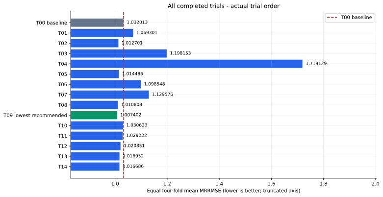
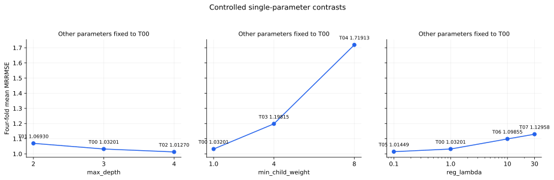
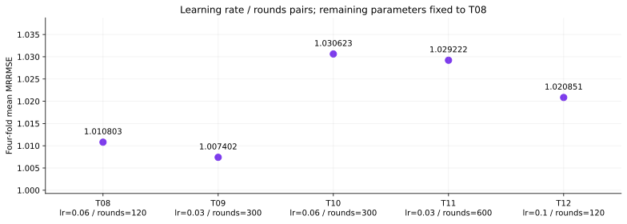
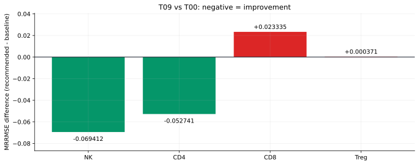

# XGBoost tuning: identity inputs, PCA160 — 2026-11-17

**Recommendation: T09**, the lowest equal-weight four-fold MRRMSE among the **15 configurations actually evaluated in this search**. Its mean is **1.007402**, versus **1.032013** for T00: an absolute reduction of **0.024612**, or **2.3848%**. T08 is a faster alternative. These are validation-selection results, not independent test performance or evidence of unseen-drug generalization.

This archive contains the completed Expanse experiment, not a new training run. All 15 configurations completed NK, CD4, CD8 and Treg validation (60 fits). One additional NK smoke fit checked execution and is excluded from ranking. No Kaggle score was used to select parameters.

[All results CSV](reports/results.csv) · [60 fold records](reports/fold_results.csv) · [HTML report](reports/BDD_XGBoost_Tuning_Report.html) · [Actual search decisions](SEARCH_LOG.md)

Download the HTML and open it in a browser to view the interactive-page layout; GitHub displays its source. The report embeds its figures and needs no external resources. Download the run directory to keep its companion CSV/script links available.

## Baseline and top three

Scores below are gene-space MRRMSE (lower is better). Time is the recorded total model-stage time for four sequential folds, including fitting, prediction, scoring, monitoring and result-writing overhead; it excludes preprocessing, environment startup and queue wait.

| Trial | NK | CD4 | CD8 | Treg | Four-fold mean | Improvement vs T00 | Model time (s) |
|---|---:|---:|---:|---:|---:|---:|---:|
| T00 baseline | 1.154120 | 1.034483 | 0.854331 | 1.085120 | 1.032013 | — | 30.81 |
| **T09 recommended / rank 1** | **1.084709** | **0.981742** | 0.877665 | 1.085490 | **1.007402** | **2.3848%** | 91.44 |
| T08 rank 2 | 1.091626 | 0.988234 | 0.879022 | 1.084331 | 1.010803 | 2.0552% | 36.92 |
| T02 rank 3 | 1.103203 | 1.008598 | 0.856440 | 1.082563 | 1.012701 | 1.8713% | 36.52 |

| Trial | Rounds (`n_estimators`) | `learning_rate` | `max_depth` | `min_child_weight` | `reg_lambda` | `subsample` | `colsample_bytree` |
|---|---:|---:|---:|---:|---:|---:|---:|
| T00 | 120 | 0.06 | 3 | 1 | 1 | 0.9 | 0.9 |
| T09 | 300 | 0.03 | 4 | 1 | 0.1 | 0.9 | 0.9 |
| T08 | 120 | 0.06 | 4 | 1 | 0.1 | 0.9 | 0.9 |
| T02 | 120 | 0.06 | 4 | 1 | 1 | 0.9 | 0.9 |

All four share `objective=reg:squarederror`, `tree_method=hist`, `device=cuda`, `multi_strategy=one_output_per_tree`, `max_bin=256`, `n_jobs=2`, `random_state=42`. [configs.json](configs.json) contains trial overrides; [runner.py](runner.py) defines the base parameters; each [trial JSON](results/T09.json) and the results CSV stores the fully resolved parameters. Unspecified library settings use XGBoost 3.2.0 defaults.



## Why T09?

1. **Direct depth evidence:** T00/T01/T02 differ only in `max_depth=3/2/4`. T02's depth 4 reduces the mean from 1.032013 to 1.012701. This supports depth 4 within this tested setting, not universally.
2. **Direct regularization evidence:** T05 changes only T00's `reg_lambda` from 1 to 0.1 and reaches 1.014486. T08 combines depth 4 and lambda 0.1. T02→T08 isolates lambda at fixed depth 4 (1.012701→1.010803); T05→T08 isolates depth at lambda 0.1. The combined gains need not be additive.
3. **Learning-rate/rounds combination:** T08→T09 changes **both** learning rate (0.06→0.03) and rounds (120→300), reducing the mean to 1.007402. Attribute that contrast to the **pair**, not to one parameter alone. T10 keeps 300 rounds but uses 0.06 (1.030623); T11 keeps 0.03 but uses 600 rounds (1.029222). Those additional controls support the selected pair among the values actually tested.
4. **Retained baseline settings:** Child weights 4 and 8 were worse than 1 in T00/T03/T04; weight 2 was not evaluated. Lowering either sampling fraction to 0.7 from T09 (T13/T14) also worsened the mean. Thus `min_child_weight=1`, `subsample=0.9` and `colsample_bytree=0.9` remain baseline values with these limited comparisons. PCA160, seed, strategy, `max_bin` and the objective were fixed, not tuned.

T09 improves on T08 by only **0.003402** mean MRRMSE while taking **91.44 vs 36.92 seconds** (about 2.48× model time). T08 uses about 60% less model time, so it is a reasonable speed-oriented alternative. T09 is recommended because the stated selection criterion was the lowest four-fold mean. There are no repeated-seed runs or confidence intervals establishing that this small difference is statistically robust.





### Improvement is concentrated in NK and CD4

| Fold | T09 − T00 | Interpretation |
|---|---:|---|
| NK | −0.069412 | Improvement |
| CD4 | −0.052741 | Improvement |
| CD8 | +0.023335 | Worse |
| Treg | +0.000371 | Approximately unchanged, slightly worse |

Only two of four folds improve; this is **not** a uniform or majority-of-fold improvement. Relative to T08, T09 changes NK/CD4/CD8/Treg by −0.006917/−0.006492/−0.001356/+0.001159 respectively. The mean criterion trades stronger NK/CD4 performance against CD8 performance relative to baseline.



## Data, splits and metric

- Input data: Kaggle `open-problems-single-cell-perturbations`, `de_train.parquet`, 614 cell–drug rows, 5 metadata columns and 18,211 gene targets. Raw data is excluded. File size: 92,135,550 bytes; SHA256: `b5fa2f763dd98b7662ec8819209cf97e68022e33a575df77d43d1153f7c5ac76`.
- Four fixed sparse-cell folds come from [source/split_data.py](source/split_data.py), `make_sparse_splits`. The 15 non-control drugs shared by B cells and Myeloid cells define anchors. For each target cell type, hold out its non-control, non-anchor pairs; retain all other rows. CD8 has 13 observed anchors, the other target types 15. Validation drugs are present in training in other cell types.
- [fold_manifests.json](fold_manifests.json) records exact pair identities. NK/CD4/Treg have 485 train and 129 validation rows; CD8 has 487 train and 127 validation rows. These are the existing sparse-cell folds, **not** the earlier random 80/20 or CD4-only split.
- Inputs: one-hot `cell_type` and `sm_name`, 152 encoded dimensions per fold, float32, unknown categories ignored. No baseline RNA or molecular embedding is used in this run.
- Outputs: PCA160 with randomized solver and seed 42. Encoder and PCA fit only each fold's training rows; identical fold preprocessing is reused across configurations in each job. PCA predictions are inverse-transformed to 18,211 genes before evaluation.
- Fold MRRMSE is the mean of per-row RMSE across genes, calculated in float64. Ranking is the **equal-weight mean of four fold scores**, not the pooled mean of all 514 validation rows. Training uses squared error on PCA targets; selection uses original-gene-space MRRMSE.
- Fixed boosting rounds, no early stopping. No per-round original-gene-space learning curves were saved, so none are claimed or reconstructed from PCA-space RMSE.

## Provenance and execution records

Runtime code was adapted from the valid notebook at **[f86455660132b95f53ba312dd070fdff64972358](https://github.com/hallenfan222/Biomedical-Data-Design/blob/f86455660132b95f53ba312dd070fdff64972358/Singlecell_perturbations/XGBoost.ipynb)**. This is the **running-code source**, not the later Git commit adding this archive. The cluster checkout was `a1164baaca78565439c729d6c021243658cae1d4`; its notebook contained literal merge conflicts and was left unchanged. The archive branch was also based on that latest `origin/main` commit at archival time. No original notebook or existing results were edited.

Compatibility adaptation: replace Colab I/O with CLI/project paths; use the existing CUDA XGBoost 3.2.0 environment rather than the notebook's ≥3.4 guard; verify actual CUDA and multi-output strategy on each fit; use `Booster.predict(DMatrix)` instead of CPU-input inplace prediction. Preserve the split, train-only preprocessing, PCA160 and gene-space metric. The actual [runner](runner.py), [Slurm script](run.sbatch), split source and report generator are archived byte-for-byte.

Recorded runtime: Python 3.11.18; XGBoost 3.2.0 (`xgboost-cu12` distribution); NumPy 1.26.4; pandas 2.2.3; scikit-learn 1.5.2; pyarrow 17.0.0. GPU: Tesla V100-SXM2-32GB. Activation loaded CUDA toolkit **12.2.2**; NVIDIA driver **580.178.04** reported CUDA **13.0** capability (not the loaded toolkit version). The reused environment also contains unrelated packages; PyBoost was not tuned.

[requirements-lock.txt](requirements-lock.txt) is the original environment inventory, **not a portable installation recipe**: it includes a build-local `packaging @ file:///...` entry and unrelated packages. Reuse the existing runtime when possible. For another host, arrange a compatible Linux NVIDIA/CUDA environment with the core versions above and installable equivalents of dependencies; do not blindly install this inventory. Plot regeneration additionally uses Matplotlib (recorded 3.11.2).

| Slurm job | Purpose | Final state | Elapsed | Reviewed record |
|---|---|---|---|---|
| 55819475 | T00 NK-only smoke, excluded from ranking | COMPLETED, 0:0 | 3m30s | [excerpt](logs/55819475.excerpt.log) |
| 55819987 | T00–T07: baseline and single-parameter exploration | COMPLETED, 0:0 | 4m10s | [excerpt](logs/55819987.excerpt.log) |
| 55820225 | Preparation incident; cancelled before execution | CANCELLED while pending | 0s | [accounting](logs/cancelled-setup-sacct.txt) |
| 55820238 | T08–T12: combined structure and rate/rounds | COMPLETED, 0:0 | 7m37s | [excerpt](logs/55820238.excerpt.log) |
| 55820747 | T13–T14: sampling controls against T09 | COMPLETED, 0:0 | 3m26s | [excerpt](logs/55820747.excerpt.log) |

See [all job accounting](logs/all-jobs-accounting.txt) for start/end timestamps and [SEARCH_LOG.md](SEARCH_LOG.md) for actual decisions and preparation errors. The cancelled preparation job did not evaluate a model and is not one of the 15 trials. No trial failed or remained incomplete. Only one GPU job ran at a time. All training jobs recorded node `exp-8-59`.

Slurm accounting uses Pacific time (UTC−8 on this date); result contexts and later decision entries use UTC. The run date uses America/New_York, 2026-11-17; some UTC entries are 2026-11-18. Model timings are not Slurm elapsed times and are approximate performance comparisons, not controlled timing benchmarks. GPU memory was sampled every 0.5 seconds; the sampled maximum is a lower bound (T09 448 MiB), not a guaranteed instantaneous peak.

## Reproduce T09

### In the original Expanse directory

Requires access to Slurm account `jhu159`, the existing data and runtime. The following is a **future reproduction command**; no training was rerun to create this archive.

```bash
cd /expanse/lustre/projects/jhu159/zfan11/xgb-tuning-20261117
sbatch run.sbatch --ids T09 --out reproduction-T09
```

The four folds run sequentially on one GPU. Choose a fresh `--out` directory for each repetition: the runner skips completed results already present there and refuses to overwrite incomplete ones.

### From a GitHub checkout on Expanse

The historical `run.sbatch` deliberately retains the original absolute environment, work and log paths. **Do not run it unchanged from another checkout.** Instead copy this archive to a writable run directory, supply the licensed competition data and an accessible activation script, and override account/resources as needed:

```bash
# Start at the root of the repository containing this archive.
export BDD_ARCHIVE="$PWD/Singlecell_perturbations/xgboost_results/tuning/2026-11-17-identity-pca160"
export BDD_REPRO="/your/writable/project/xgb-T09-reproduction"
export BDD_ACTIVATE="/expanse/lustre/projects/jhu159/zfan11/bdd-runtime/activate.sh"
export BDD_DATA_FILE="/path/to/de_train.parquet"

mkdir -p "$BDD_REPRO"
cp -R "$BDD_ARCHIVE/." "$BDD_REPRO/"
mkdir -p "$BDD_REPRO/data" "$BDD_REPRO/logs"
ln -s "$BDD_DATA_FILE" "$BDD_REPRO/data/de_train.parquet"

sbatch --account=jhu159 --partition=gpu-shared --nodes=1 --ntasks=1 \
  --cpus-per-task=10 --mem=96G --gpus=1 --time=00:15:00 \
  --export=ALL --chdir="$BDD_REPRO" --output="$BDD_REPRO/logs/%j.log" \
  --wrap='set -eo pipefail; source "$BDD_ACTIVATE"; export PYTHONDONTWRITEBYTECODE=1; nvidia-smi; python -u runner.py --ids T09 --out reproduction-T09'
```

Replace `/your/...` and `/path/...`, confirm your allocation and activation-script permissions, and start with a new reproduction directory. The runner requires Linux/Slurm, CUDA XGBoost, `nvidia-smi` and `fcntl`; it verifies the exact data hash. `source/runtime-activate-reference.sh` documents the original modules/environment path; it is not a credential or a transferable environment. The runner regenerates `fold_manifests.json` from the hash-checked data and saved split code; compare it with the archived manifest. A copied directory keeps these writes out of the Git archive. New timing/job IDs and small hardware-dependent numerical differences are expected.

### Validate or regenerate reports without training

From this archive (or a writable copy):

```bash
python validate_results.py
python audit_archive.py
# In the existing runtime, or a Python environment with Matplotlib:
python generate_report.py
```

The first two checks use only Python's standard library and saved artifacts; they do not load raw data or train. Report generation reads saved `results/T*.json`, configs and narrative files and regenerates CSV/HTML/SVG; use a copy if you want the original report bytes unchanged. Its displayed paths are based on its working location; for training outside the historical run use the checkout instructions above. Do not replace archived results with reproduction outputs.

## File index and archival boundaries

| File / directory | Role |
|---|---|
| [reports/results.csv](reports/results.csv) | 15 completed trials, all resolved parameters, four fold scores, mean, timing and original Slurm log paths |
| [reports/fold_results.csv](reports/fold_results.csv) | All 60 validation fits, dimensions, fit/preprocessing times, CUDA device and sampled memory |
| [reports/controlled_contrasts.csv](reports/controlled_contrasts.csv) | Exact changed parameters and fold deltas for actual comparisons |
| [reports/trial_status.csv](reports/trial_status.csv) | Status of every trial (all complete) |
| [reports/BDD_XGBoost_Tuning_Report.html](reports/BDD_XGBoost_Tuning_Report.html) | Original standalone report, including embedded figures |
| [configs.json](configs.json), [results/](results/) | Actual configuration plan, full per-trial JSON, smoke result and run contexts |
| [runner.py](runner.py), [run.sbatch](run.sbatch), [source/split_data.py](source/split_data.py) | Actual training entry point, original Slurm script and fixed split implementation |
| [fold_manifests.json](fold_manifests.json) | Exact train/validation pair identities |
| [generate_report.py](generate_report.py), [validate_results.py](validate_results.py) | Actual plotting/report and result-check scripts |
| [audit_archive.py](audit_archive.py), [ARCHIVE_SHA256.json](ARCHIVE_SHA256.json) | Added archival integrity/link/CSV/log checks and hashes of unchanged original files |
| [SEARCH_LOG.md](SEARCH_LOG.md), [CONCLUSION.md](CONCLUSION.md), [PROVENANCE.md](PROVENANCE.md) | Original search chronology, detailed interpretation and run provenance |
| [logs/](logs/) | Reviewed structured log excerpts and scheduler accounting; full log paths in CSV refer to Expanse |
| [requirements-lock.txt](requirements-lock.txt), [runtime activation reference](source/runtime-activate-reference.sh) | Original environment inventory and activation reference |

Original provenance statements such as “no commit/push” describe the **training phase**, before this archival PR. References there to a full notebook snapshot, complete GPU traces or the downloadable ZIP describe the original bundle, not files all included here. The historical notebook can be read at the pinned GitHub commit above.

Retained on Expanse, not committed here: raw `data/de_train.parquet`, installed runtime and caches, the source repository/extra historical notebook snapshot, full terminal logs, per-process GPU sampling CSVs, quota snapshots, packaging/preparation helpers, and the downloadable ZIP. No model weights, credentials or raw expression values are included. Log excerpts retain only reviewed structured run records; they preserve source values without including unrelated terminal output. Existing repository results and notebooks remain unchanged.
